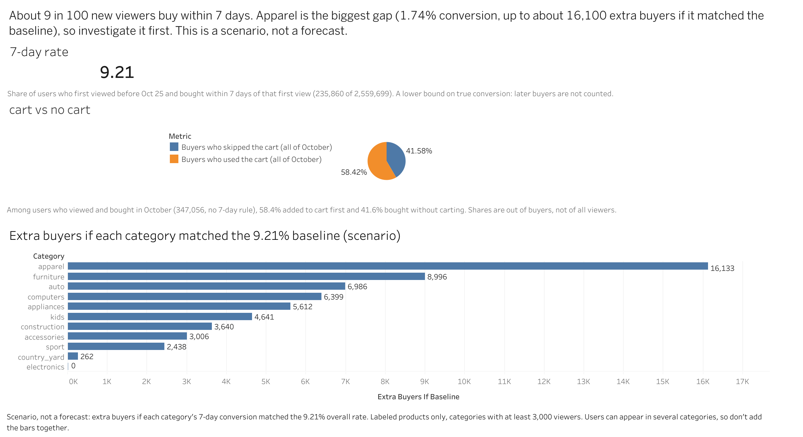

# E-commerce Funnel Analysis

Where do shoppers drop off before buying, and which product category is worth investigating first?

**Dashboard:** https://public.tableau.com/views/E-com-funnel-analysis/E-commerceFunnelAnalysis?:language=en-US&:sid=&:redirect=auth&:display_count=n&:origin=viz_share_link

**Notebook:** [notebook/ecommerce-funnel-analysis.ipynb](notebook/ecommerce-funnel-analysis.ipynb)

**Data:** Kaggle, "E-commerce behavior data from multi-category store" (October 2019 file, 42.4M events)

## Business question

Marketing, product and category teams lack evidence on where users are lost in the purchase journey and whether the loss is concentrated in specific categories. This project measures the funnel, compares categories, and proposes one test. It describes behavior only. It cannot say why users behave this way.

## Key findings

| Finding | Number | Notes |
|---|---|---|
| 7-day conversion | **9.21%** (235,860 of 2,559,699 users) | Plausible range 9.18% to 9.25%. Users who first viewed before Oct 25; purchase within 7 days of first view. A lower bound on true conversion. |
| Cart use among buyers | **58.4% used the cart, 41.6% skipped it** | 347,056 buyers, all of October, no 7-day rule. Shares are out of buyers, not viewers. |
| Biggest category gap | **Apparel 1.74%** vs furniture 2.54% | Apparel plausible range 1.69% to 1.80%; furniture 2.46% to 2.63%. Ranges do not overlap, so the gap is very unlikely to be luck. |
| Browsing before buying | Median 2 products for buyers and non-buyers | Buyers are only modestly higher in the upper tail (95th percentile 15 vs 12). |

## Key decisions

- **Unit of analysis:** unique users, not events. Repeat views would inflate every stage.
- **Two routes to purchase:** 41.6% of buyers never carted, so "89% are lost at cart" would be wrong.
- **Cohort rule:** only users with a full 7 days left in the data are included.
- **Cart-to-purchase window:** 24 hours, chosen from the measured distribution (95th percentile about 17 hours, measured from the first cart, so an upper bound).
- **Categories:** sub-category level, labeled products only, minimum 3,000 viewers.

## Data quality

- 35,207 duplicate events (0.083%) removed. They were spread thinly across users, so they look like logging noise.
- `category_code` is missing in 31.84% of rows and `brand` in 14.41%. Missingness belongs to the product: every product is either fully labeled or fully unlabeled. Category results therefore cover labeled products only.
- No prices at or below zero among purchases.

## Scenario: category opportunity

If a category matched the 9.21% baseline, apparel would gain about **16,133 extra buyers**. This is a **scenario, not a forecast**. The baseline is an assumption, apparel may never convert like electronics, and users can appear in several categories, so the numbers should not be added together.

## Proposed experiment (planned, NOT run)

**Status: this is a design. We have no result.** October's data is a record of what already happened, with no random assignment and no changes to the live site.

| Item | Plan |
|---|---|
| Hypothesis | Adding a size guide to apparel product pages will increase the share of apparel viewers who buy within 7 days |
| Design | Random split: control sees the page as is, treatment sees the size guide |
| Primary metric | Share of apparel viewers who buy within 7 days (baseline 1.74%) |
| Guardrail | Share of apparel orders returned (not in our data; we would ask the company) |
| Smallest lift to detect | 0.25 points (1.74% to 1.99%) |
| Sample size | About 45,917 users per group, about 92,000 in total |
| Assumptions | 5% risk of a false win, 80% chance of catching a real lift, 50/50 split |

**Business scenario (assumptions, not results):** a 0.25-point lift on 216,093 apparel viewers is about 540 extra buyers. At the median apparel item price of 71.82, that is roughly 38,800 in revenue a month, before costs.

## Recommendation

Investigate apparel first, starting with the size guide test above. Do not commit to a full redesign until we know why conversion is low.

## Limitations

- One month of data (October). No retention or seasonality.
- Category results cover labeled products only (about 44% of products).
- The 7-day figure excludes slow buyers and users who first viewed after Oct 24.
- `price` is revenue, not profit. No cost, margin, returns or traffic-source data.
- No order ID, so revenue is estimated per purchased item.
- Observational data only: nothing here proves a cause.

## What I would ask the company for

Returns data (for the guardrail), cost and margin, traffic source, category labels for unlabeled products, and more than one month of history.

## Repository contents

- `notebook/ecommerce-funnel-analysis.ipynb` - the full analysis, from loading to the experiment design
- `data/funnel.csv`, `data/opportunity.csv`, `data/test_plan.csv` - small summary tables used by the dashboard
- `dashboard/dashboard-screenshot.png` - screenshot of the Tableau dashboard

